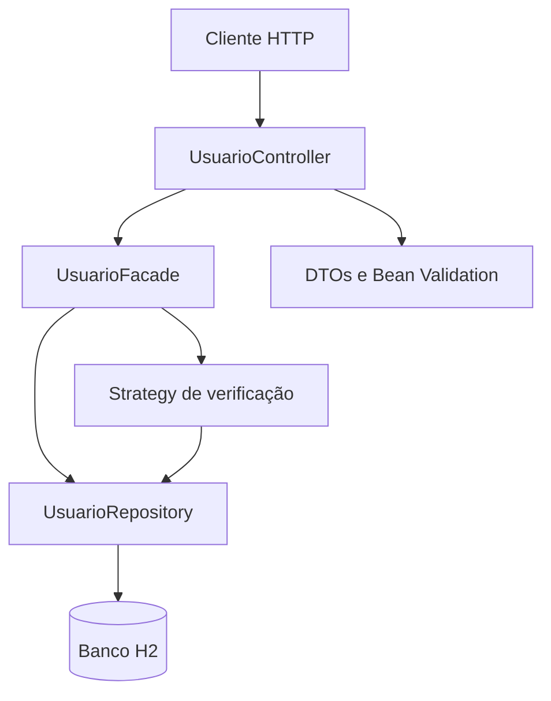

# Usuários API

[](https://www.oracle.com/java/)
[](https://spring.io/projects/spring-boot)
[](https://github.com/LucasDaniel28/usuarios-api/actions/workflows/maven.yml)

API REST para cadastro, consulta e verificação de usuários, desenvolvida com Java 21 e Spring Boot. O projeto demonstra organização em camadas, validação de entrada, persistência com Spring Data JPA e aplicação dos padrões Facade e Strategy.

## Visão geral

A API permite:
- Cadastrar usuários com validação de nome, e-mail e endereço.
- Listar usuários cadastrados.
- Consultar um usuário pelo identificador.
- Verificar a existência de um usuário por ID ou e-mail.
- Impedir cadastros com e-mail já utilizado.

## Tecnologias

| Tecnologia | Uso |
|---|---|
| Java 21 | Linguagem |
| Spring Boot 3.4.5 | Inicialização e configuração da aplicação |
| Spring Web | Criação dos endpoints REST |
| Spring Data JPA | Persistência e acesso a dados |
| Bean Validation | Validação dos dados de entrada |
| H2 Database | Banco de dados para desenvolvimento local |
| Maven | Gerenciamento de dependências e build |
| JUnit / Spring Boot Test | Testes automatizados |

## Arquitetura

O fluxo principal de uma requisição é:



### Organização do código

```text
src/
├── main/
│   ├── java/br/com/exemplo/usuarios/
│   │   ├── controller/       # Endpoints REST
│   │   ├── dto/              # Objetos de entrada e saída
│   │   ├── model/            # Entidade JPA
│   │   ├── repository/       # Acesso ao banco
│   │   ├── service/          # Coordenação dos casos de uso
│   │   └── strategy/         # Estratégias de verificação
│   └── resources/
│       └── application.properties
└── test/
    └── java/br/com/exemplo/usuarios/
        └── UsuarioControllerIntegrationTest.java
```

## Pré-requisitos

- JDK 21
- Maven 3.6.3 ou superior

Confira se as ferramentas estão disponíveis:

```bash
java -version
mvn -version
```

## Como executar

Clone o repositório e acesse a pasta do projeto:

```bash
git clone https://github.com/LucasDaniel28/usuarios-api.git
cd usuarios-api
```

Inicie a aplicação:

```bash
mvn spring-boot:run
```

A API ficará disponível em `http://localhost:8080`.

Para gerar o artefato e executar o JAR:

```bash
mvn clean package
java -jar target/usuarios-api-0.0.1-SNAPSHOT.jar
```

## Endpoints

Base URL: `http://localhost:8080/api/usuarios`

| Método | Endpoint | Descrição | Resposta esperada |
|---|---|---|---|
| `POST` | `/api/usuarios` | Cadastra usuário | `201 Created` |
| `GET` | `/api/usuarios` | Lista usuários | `200 OK` |
| `GET` | `/api/usuarios/{id}` | Busca por ID | `200 OK` ou `404 Not Found` |
| `GET` | `/api/usuarios/verificar?tipo=id&valor=1` | Verifica ID | `200 OK` |
| `GET` | `/api/usuarios/verificar?tipo=email&valor=ana@exemplo.com` | Verifica e-mail | `200 OK` |

### 1. Cadastrar usuário

Requisição:

```http
POST /api/usuarios
Content-Type: application/json
```

Corpo JSON:

```json
{
  "nome": "Ana Silva",
  "email": "ana@exemplo.com",
  "endereco": "Rua das Flores, 123"
}
```

Resposta de sucesso (`201 Created`):

```json
{
  "id": 1,
  "nome": "Ana Silva",
  "email": "ana@exemplo.com",
  "endereco": "Rua das Flores, 123"
}
```

Os campos são obrigatórios. O e-mail deve ter formato válido, e os campos possuem limites de tamanho definidos no DTO. Um e-mail já cadastrado retorna `409 Conflict`.

### 2. Listar usuários

```http
GET /api/usuarios
```

Resposta ilustrativa:

```json
[
  {
    "id": 1,
    "nome": "Ana Silva",
    "email": "ana@exemplo.com",
    "endereco": "Rua das Flores, 123"
  }
]
```

### 3. Buscar por ID

```http
GET /api/usuarios/1
```

Se não houver usuário com o identificador informado, a API retorna `404 Not Found`.

### 4. Verificar existência

Por ID:

```http
GET /api/usuarios/verificar?tipo=id&valor=1
```

Por e-mail:

```http
GET /api/usuarios/verificar?tipo=email&valor=ana@exemplo.com
```

Resposta:

```json
{
  "tipo": "email",
  "valor": "ana@exemplo.com",
  "existe": true
}
```

O parâmetro `tipo` aceita `id` ou `email`. Um tipo diferente retorna `400 Bad Request`; o campo `existe` informa se o registro foi encontrado.

## Testes

Execute a suíte automatizada com:

```bash
mvn test
```

O projeto também executa `mvn clean verify` no GitHub Actions em pushes e pull requests direcionados à branch `main`.

## Banco de dados

O projeto usa H2 em arquivo, com URL `jdbc:h2:file:./data/usuariosdb`. O diretório `data/` é ignorado pelo Git para evitar versionar os arquivos locais do banco.

Durante o desenvolvimento, o console H2 fica disponível em `http://localhost:8080/h2-console`:

- JDBC URL: `jdbc:h2:file:./data/usuariosdb`
- Usuário: `sa`
- Senha: em branco

Essa configuração é voltada ao ambiente local. Não exponha o console H2 nem utilize credenciais padrão em ambientes públicos.

## Conceitos aplicados

- **Facade:** `UsuarioFacade` coordena os casos de uso de cadastro, consulta e verificação.
- **Strategy:** `VerificarPorId` e `VerificarPorEmail` encapsulam as diferentes regras de verificação.
- **Injeção de dependência:** dependências são recebidas por construtor.
- **DTOs e validação:** separam o contrato HTTP da entidade persistida e validam os dados de entrada.
- **Separação de responsabilidades:** controller, serviço, repositório, DTOs e entidade têm papéis distintos.

## Próximas melhorias

- Adicionar paginação e ordenação à listagem.
- Padronizar o formato dos erros de validação e de negócio.
- Tratar explicitamente conflitos de unicidade causados por requisições concorrentes.
- Adotar migrações de banco de dados para ambientes persistentes.
- Configurar autenticação, autorização e variáveis de ambiente antes de qualquer implantação pública.

## Escopo e limitações

Este projeto tem finalidade de estudo e demonstração. Não deve ser considerado pronto para produção sem as melhorias de segurança, observabilidade, tratamento de erros e escalabilidade descritas acima.
